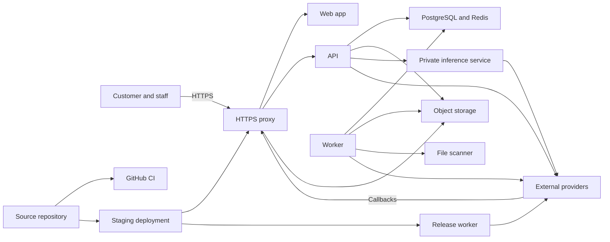

# Barghsa threat model

## Executive summary

Barghsa's highest-impact abuse paths cross an ownership, staff authority, or payment boundary. A successful bypass can disclose another profile's contracts and documents, bind a compromised account to a new contact, or move money without a valid obligation. The release review also covers untrusted files, provider credentials, assistant output, and the integrity of the deployed images.

## Scope and assumptions

- The first launch covers electricity, saving, solar, and consultation, including account setup, staff review, fulfillment, contracts, payment, refunds, and support. This model covers the public web and API, worker and inference processes, PostgreSQL, Redis, object storage, scanners, provider integrations, and the build and deployment path. [Release scope](../kanban/RELEASES.md).
- The reference runtime is the staging topology in source. Browser and webhook traffic enters through the HTTPS proxy. App components and backing stores communicate on the private network. The selected production ingress, database topology, recovery evidence, and alert destinations require separate verification. [Staging topology](../deploy/staging/compose.yml). [Production deployment](../deploy/production/README.md).
- Accounts may own or represent multiple profiles. Current profile ownership or active agent membership governs customer access. Staff operate in a distinct session context with explicit capabilities. The owner approved server-managed active-profile preferences and module-wide staff document reads where an explicit grant allows them. [Authorization policy](security/authorization.md).
- The launch assistant answers from currently published, audience-scoped knowledge. The owner deferred profile-data tools and business writes. The external Telegram relay and its network routing are staging-specific. [Assistant delivery decision](decisions/ai-assistant-delivery.md). [Telegram service host](operations/telegram-host.md).
- Provider internals, customer devices, and the cloud hosting control plane sit outside the code review. Their compromise or unavailability is an input to the threat model. Production traffic scale, final public TLS scope, recovery capacity, and any new live merchant or assistant integration can change likelihood and impact. Record those facts in the production approval package as they become verifiable. [Release workflow](../kanban/WORKFLOW.md).

## System model

### Primary components

- The React web app and NestJS API implement the browser and application surfaces. The worker processes durable business and delivery jobs. A dedicated inference process provides an internal model endpoint. [API bootstrap](../apps/api/src/app.factory.ts). [Worker entry point](../apps/worker/src/main.ts). [Inference service](../apps/worker/src/ai-inference/server.ts).
- PostgreSQL holds session authority, business state, ledger and audit records, configuration, and durable jobs. Redis supports shared coordination and request limits. Object storage holds document bytes and ClamAV provides a scan boundary. [Staging services](../deploy/staging/compose.yml). [Document storage](../apps/api/src/documents/document-storage.service.ts).
- GitHub CI builds and checks application images and source. Staging deployment takes an immutable commit, runs migrations, checks readiness, and verifies the live release identity before the release worker announces it. This control plane has separate credentials from the runtime. [CI workflow](../.github/workflows/ci.yml). [Staging deployment](../deploy/staging/deploy.sh).
- Electricity persists the reviewed order and pricing snapshot. Saving binds hardware and stock changes to order and invoice state. Solar progression depends on the contract and postal evidence. Consultation has separate assignment, workflow and payment authority. Each path requires its own scoped business decision before returning private state or accepting a transition. [Electricity order](../apps/api/src/electricity/electricity-order.service.ts). [Saving fulfillment](../apps/api/src/saving/saving-fulfillment.service.ts). [Solar progress](../apps/api/src/solar/solar-progress.service.ts). [Consultation workflow](../apps/api/src/consultation/consultation-workflow.service.ts).

### Data flows and trust boundaries

| Boundary                                                           | Data and channel                                                                              | Authorization and validation                                                                                                                                                                                                                                                                                                                   |
| ------------------------------------------------------------------ | --------------------------------------------------------------------------------------------- | ---------------------------------------------------------------------------------------------------------------------------------------------------------------------------------------------------------------------------------------------------------------------------------------------------------------------------------------------- |
| B1 Browser → proxy → web and API                                   | HTTPS, credentials, cookies, profile choices, JSON commands and reads                         | Secure session cookies, scoped authentication and CSRF, server-side validation, current authority, and request limits. Native CSP telemetry has a narrow exception. [Cookies](security/cookies.md). [CSP](security/content-security-policy.md).                                                                                                |
| B2 API and workers → PostgreSQL and Redis                          | Private data connections, session state, money, configuration, queues, and limits             | Parameterized values, current resource authority, migrations and constraints, and transactional changes to balances, audit and outbox. [Authorization](security/authorization.md). [Wallet settlement](../apps/api/src/wallet/pay-invoice-with-wallet.service.ts).                                                                             |
| B3 Browser and app → object storage → scanner                      | Staged PUTs, signed reads, PDF and image bytes, checksums and scan results                    | Scope and policy checks before issuing a URL. Verify stored bytes, size, MIME and checksum before trusted use. Authorize private reads, preserve signed records, and record access evidence. [Document service](../apps/api/src/documents/document.service.ts). [Retention](operations/storage-retention.md).                                  |
| B4 Providers → proxy → API                                         | HTTPS callbacks for payments, email events and Telegram updates                               | Issuer-specific authentication, bounded inputs and replay handling. Payment confirmation checks durable merchant, amount and authority binding. Browser payment return uses a read-only status path. [Payment signatures](../apps/api/src/wallet/payment-callback-verifier.ts). [Payment verification](operations/staging-payment-sandbox.md). |
| B5 API and workers → external providers                            | HTTPS and SMTP over TLS, encrypted configuration, recipient messages and payment references   | Protected provider credentials, tested activation, destination checks, durable claims and reconciliation for uncertain sends. [SMTP destination guard](../packages/shared/src/auth-delivery/smtp-network-guard.ts). [Delivery recovery](operations/notification-delivery-recovery.md).                                                         |
| B6 API → inference service → model provider                        | Private authenticated inference requests, prompts, source excerpts and model responses        | Service authentication, published audience scope, bounded admission and usage, output validation before release, and current requester authority. [Inference operations](operations/ai-inference.md). [Knowledge chat](../apps/api/src/ai-agents/ai-knowledge-chat.service.ts).                                                                |
| B7 Source repository → CI and staging deployment → release channel | Source, image metadata, rollout controls, protected release credentials and delivery receipts | The required integrity check protects the source ref. The detached worker deploys the verified milestone SHA independently of the hosted CI run and checks health and live metadata. Production needs explicit owner authorization. [CI modes](development/ci.md). [Release workflow](../kanban/WORKFLOW.md).                                  |

#### Diagram

## Assets and security objectives

| Asset                                                                          | Why it matters                                                                          | Objective                                    |
| ------------------------------------------------------------------------------ | --------------------------------------------------------------------------------------- | -------------------------------------------- |
| Password hashes, contacts, OTPs, sessions and grants                           | Account takeover can expose identity and authorize further actions                      | Confidentiality and integrity                |
| Profile identities, addresses, documents, signed versions, and support history | Disclosure harms customers and changes can alter evidence or obligations                | Confidentiality, integrity, and availability |
| Orders, invoices, balances, payment intents and refund obligations             | Duplicate or unauthorized effects can create financial loss and liability               | Integrity and availability                   |
| Audit records, receipts, migration history, and backup copies                  | Incident response and reconciliation depend on provable decisions and recoverable state | Integrity and availability                   |
| Provider keys, routing and security configuration                              | Credential theft or malicious routing can cross an application trust boundary           | Confidentiality and integrity                |
| Published knowledge, inference budgets, and output policies                    | A leak can disclose restricted knowledge and abuse can exhaust service capacity         | Confidentiality, integrity, and availability |
| Build artifacts, deployment identity, and release credentials                  | A compromised artifact can run with service authority                                   | Integrity and confidentiality                |

## Attacker model

### Capabilities

- An external caller can automate public requests, vary headers and bodies, replay captured traffic where applicable, and attempt credential stuffing or denial of service.
- A customer or agent can use valid sessions, substitute known identifiers, upload hostile files, race operations, or retain stale access after a role change. A staff account can exercise its granted operations and attempt to exceed them.
- A compromised admin, provider, source account, or CI dependency has a distinct threat profile. An admin can submit configuration changes. A provider can return malformed results or send callbacks that must still bind to the expected intent.

### Non-capabilities

- Ordinary public callers have no direct PostgreSQL, Redis, worker, deployment, or provider-key access under the reference topology. Cross-boundary access would require a separate exploit or privileged compromise.
- Customer traffic carries no trusted staff permission or provider identity by declaration. Provider signatures, session authority and current resource scope come from independent verification.

## Entry points and attack surfaces

| Surface                                    | How reached                                                       | Boundary   | Notes and evidence                                                                                                                                                                                            |
| ------------------------------------------ | ----------------------------------------------------------------- | ---------- | ------------------------------------------------------------------------------------------------------------------------------------------------------------------------------------------------------------- |
| Login, OTP, recovery and profile switching | Public auth and session APIs                                      | B1, B2     | Attempt limits, expiry, revocation, and proof of contact or identity. [OTP controls](security/otp.md). [Session guard](../apps/api/src/session/session.guard.ts).                                             |
| Customer and staff business commands       | Authenticated JSON HTTP                                           | B1, B2     | Profile access and capability checks, business transitions, exact money and retry keys. [Authorization](security/authorization.md).                                                                           |
| Upload, preview, download and retention    | API-issued signed URLs and worker scans                           | B2, B3     | Untrusted metadata and parsers, verified bytes, immutable records and scoped delivery. [Document service](../apps/api/src/documents/document.service.ts).                                                     |
| Payment, email and Telegram integration    | Public callbacks and outbound adapters                            | B4, B5     | Signed or protected channels, replay handling, provider result parsing and durable recovery. [Delivery recovery](operations/notification-delivery-recovery.md). [Telegram host](operations/telegram-host.md). |
| Administration, audit and telemetry        | Staff API, restricted metrics and bounded report endpoints        | B1, B2, B5 | Current permission, step-up, configuration history and sanitized diagnostics. [Audit controller](../apps/api/src/admin/config-audit.controller.ts). [CSP reports](security/content-security-policy.md).       |
| Chat, knowledge publication and inference  | Customer and staff chat, admin configuration and internal request | B1, B5, B6 | Untrusted prompts, source audience, provider configuration, and usage caps. [Inference operations](operations/ai-inference.md).                                                                               |
| Build, migration, rollout and notification | CI and authorized operations                                      | B7         | Dependencies, credentials, image provenance, rollback and announcement receipts. [Supply chain](security/supply-chain.md). [Release workflow](../kanban/WORKFLOW.md).                                         |

## Top abuse paths

1. Guess credentials or target recovery, obtain a session or new contact binding, then impersonate the account and access its private records.
2. Obtain a foreign order, invoice, contract or document ID, use a valid low-privilege session, then race revocation or inject a different profile identifier to bypass scope.
3. Submit concurrent debits, confirmations or refunds, or replay a signed provider event, to move money twice or close an unsettled obligation.
4. Upload a misleading or hostile file, then cause a worker or reader to interpret it, or reuse an old signed read after access changes.
5. Gain staff configuration access, supply a private SMTP or model destination, and use provider requests to reach internal services or exfiltrate credentials.
6. Publish or submit prompt injection, retrieve restricted text or cause unsafe output, then repeat requests until the model budget or queue is exhausted.
7. Tamper with source, an image, a migration or a deployment credential, then cause the release worker to attest to an unapproved runtime.
8. Exhaust storage, scan, queue or database capacity, or corrupt operational evidence, to delay financial recovery and hide the original incident.

## Threat model table

Likelihood assumes the reference controls and a public application. Impact assumes a successful abuse path. The STRIDE mapping ties each failure mode to the affected domains.

| STRIDE category        | Threats                                                                                                              |
| ---------------------- | -------------------------------------------------------------------------------------------------------------------- |
| Spoofing               | TM-001 account identity, TM-003 provider identity, TM-007 release identity                                           |
| Tampering              | TM-003 money and payment evidence, TM-004 documents, TM-005 configuration, TM-006 assistant output, TM-007 artifacts |
| Repudiation            | TM-003 financial decisions, TM-009 audit and telemetry                                                               |
| Information disclosure | TM-002 profile isolation, TM-004 private files, TM-005 credentials, TM-006 restricted knowledge, TM-009 diagnostics  |
| Denial of service      | TM-004 scan work, TM-006 inference capacity, TM-008 dependent services and recovery                                  |
| Elevation of privilege | TM-001 account recovery, TM-002 resource authority, TM-005 privileged configuration                                  |

| ID     | Threat source                                        | Prerequisites                                                    | Threat action                                                                   | Impact                                               | Assets                                              | Existing controls                                                                                                                                                                                                                                        | Gaps                                                                                  | Mitigation and review                                                                                   | Detection                                                             | Likelihood                                       | Impact                                           | Priority |
| ------ | ---------------------------------------------------- | ---------------------------------------------------------------- | ------------------------------------------------------------------------------- | ---------------------------------------------------- | --------------------------------------------------- | -------------------------------------------------------------------------------------------------------------------------------------------------------------------------------------------------------------------------------------------------------- | ------------------------------------------------------------------------------------- | ------------------------------------------------------------------------------------------------------- | --------------------------------------------------------------------- | ------------------------------------------------ | ------------------------------------------------ | -------- |
| TM-001 | External attacker or stolen session                  | Public auth access or compromised contact                        | Spoof identity, enumerate registration or take over recovery                    | Impersonation and private account access             | Contacts, OTPs, sessions                            | Password and OTP controls, scoped recovery, current session checks and step-up. [Auth controls](security/otp.md). [Recovery](runbooks/account-recovery.md).                                                                                              | Verify pre-proof registration responses and real provider paths against the candidate | Exercise equivalent responses, recovery authority, old-session revocation and independent verification  | Rate-limit, OTP and recovery audit signals                            | medium, public routes are easy to target         | high, account authority can be reused            | high     |
| TM-002 | Customer, agent or staff                             | Valid session and resource identifier                            | Elevate privilege or disclose another profile's records                         | Customer data exposure or unauthorized action        | Contracts, invoices, wallet, documents              | Current owner, membership, capability and transaction checks. [Authorization](security/authorization.md).                                                                                                                                                | New routes and worker result paths can omit scope                                     | Retest foreign IDs, current role changes and result delivery at each resource boundary                  | Scoped denial and role-change events                                  | medium, multiple entry points expose identifiers | high, sensitive records cross a tenant boundary  | high     |
| TM-003 | Customer, staff or provider                          | Financial command access, captured event or compromised provider | Tamper with amount, replay payment, race settlement or repudiate a refund       | Duplicate money movement or false settlement         | Ledger, payment intent and refund obligation        | Signed callback, current merchant binding, exact integers, row locks, idempotency and append-only audit. [Callback verification](../apps/api/src/wallet/online-topup-callback.service.ts). [Refund processing](../packages/db/src/refund-processing.ts). | Live merchant semantics and recovery need candidate receipts                          | Exercise concurrent duplicate, mismatch and unknown provider cases, then reconcile exact ledger results | Signature failures, key conflicts, mandatory refunds and drift alerts | medium, financial paths are actively targeted    | high, loss can be immediate and irreversible     | high     |
| TM-004 | Customer or compromised staff                        | Upload or signed document access                                 | Tamper with bytes, exploit a parser, disclose a file or replace signed evidence | Malware exposure or loss of contractual evidence     | Private documents and versions                      | Two-stage upload, scan and byte verification, signed reads, retained financial and contractual records. [Document storage](../apps/api/src/documents/document-storage.service.ts). [Retention](operations/storage-retention.md).                         | Verify active scanner freshness and object retention on the selected environment      | Test mismatched bytes, spoofed MIME, denied preview and replacement lineage                             | Scan health, document access events and deletion receipts             | medium, uploads are routine                      | high, sensitive files and parsers are exposed    | high     |
| TM-005 | Staff, admin or compromised provider                 | Config grant or control of provider responses                    | Elevate authority through a config change, SSRF or credential misuse            | Internal service access and provider impersonation   | Configuration, provider keys and private endpoints  | Tested versioned activation, current staff capabilities and destination checks. [SMTP guard](../packages/shared/src/auth-delivery/smtp-network-guard.ts). [Storage configuration](operations/storage-configuration.md).                                  | Verify actual egress and certificate constraints in production topology               | Review allowlists, redirect handling, secret rotation and approval evidence                             | Provider configuration audit and connection failures                  | low, mutation needs privileged access            | high, service credentials can cross boundaries   | high     |
| TM-006 | Customer, publisher or model provider                | Chat access or influence over published material                 | Disclose restricted knowledge, tamper with output or deny service through usage | Sensitive text disclosure and exhausted capacity     | Knowledge, policy, budget and queue                 | Audience scope, output checks, authenticated inference worker and bounded usage. [Knowledge chat](../apps/api/src/ai-agents/ai-knowledge-chat.service.ts). [Inference operations](operations/ai-inference.md).                                           | Provider behavior and representative malicious prompts need live review               | Recheck publication and role changes during streaming, sensitive source rejection and model limits      | Source policy denials, queue rejection, provider and spend metrics    | medium, prompt input is open to users            | high, knowledge can be private                   | high     |
| TM-007 | Developer account, dependency or operator compromise | Build or deployment influence                                    | Tamper with code, migration or image, or spoof deployment success               | Arbitrary code with runtime privileges               | Artifacts, release credentials, data and audit      | Required integrity, SCA and image scan, immutable staging identity and health readback. [CI](../.github/workflows/ci.yml). [Staging deploy](../deploy/staging/deploy.sh).                                                                                | Verify access, exact receipts and policy against each candidate                       | Inspect scanner outputs, constrained credentials and staging/production authority separation            | Unexpected image IDs, ruleset changes and release receipt mismatch    | low, protected build access raises the bar       | high, runtime trust is broad                     | high     |
| TM-008 | External caller or degraded provider                 | Sustained traffic, queue pressure or failed dependency           | Deny service, exhaust workers, delay notifications or poison failure evidence   | Delayed service and uncertain recovery               | Worker queues, scanner, backing stores and receipts | Rate and admission limits, circuit breakers, durable queue and protected recovery. [Service objectives](operations/service-objectives.md). [Delivery recovery](operations/notification-delivery-recovery.md).                                            | Rehearse load, failover, off-server recovery and live alert delivery                  | Exercise backlog, provider outage, reconciliation and restore without widening retries                  | Queue age, circuit, readiness, restore and alert delivery receipts    | medium, outages and traffic bursts are realistic | medium, containment limits affected capabilities | medium   |
| TM-009 | Staff or malicious caller                            | Audit or telemetry access                                        | Repudiate a change or disclose secrets through logs and reports                 | Incomplete investigation and private data disclosure | Audit, logs and diagnostic fields                   | Append-only database triggers, read-only authorized audit, sanitized CSP and diagnostics. [Audit migration](../packages/db/drizzle/production/0249_audit_log_immutability.sql). [CSP](security/content-security-policy.md).                              | Verify final sink access and retention on deployed systems                            | Check sanitized payloads and actor attribution through rollback and replay                              | Missing receipts, malformed report spikes and unauthorized reads      | low, control paths constrain direct alteration   | high, evidence loss can obscure financial abuse  | medium   |

## Criticality calibration

- **Critical** means an immediately exploitable path to arbitrary runtime execution or broad unauthorized money movement. Examples include a forged callback that credits wallets across profiles and remote execution from an untrusted upload in the API process.
- **High** means exposure of private profile records or significant authority escalation. Examples include reading a foreign signed contract or reusing stale staff permission to approve a refund.
- **Medium** means bounded degradation or data exposure with identifiable scope and recovery. Examples include exhausting one notification channel or leaking a limited non-secret diagnostic field.
- **Low** means a narrow observable difference or disruption with little additional access. Examples include revealing a generic provider state without identifiers or producing a transient public status error that leaves application state intact.

## Focus paths for security review

| Path                                                                                 | Review focus                                                                  | Threats                |
| ------------------------------------------------------------------------------------ | ----------------------------------------------------------------------------- | ---------------------- |
| [Authentication and sessions](../apps/api/src/session/)                              | Verify current authority, rotation, scoped cookie and mutation checks         | TM-001, TM-002         |
| [Wallet and callback code](../apps/api/src/wallet/)                                  | Follow exact intent binding, verified provider evidence and commit boundaries | TM-003                 |
| [Contract cancellation](../apps/api/src/contract/contract-cancellation.service.ts)   | Confirm competing decisions, immutable prior versions and required settlement | TM-002, TM-003, TM-009 |
| [Document service](../apps/api/src/documents/document.service.ts)                    | Trace untrusted upload to verification, preview, read and retention           | TM-002, TM-004         |
| [SMTP destination guard](../packages/shared/src/auth-delivery/smtp-network-guard.ts) | Review resolver, permitted destinations and address pinning                   | TM-005                 |
| [Knowledge chat and worker](../apps/api/src/ai-agents/ai-knowledge-chat.service.ts)  | Follow the source audience, output release checks and inference authority     | TM-006                 |
| [CI and deploy](../.github/workflows/ci.yml)                                         | Verify exact image, scoped credentials, security checks and immutable rollout | TM-007                 |
| [Worker job entry point](../apps/worker/src/main.ts)                                 | Check bounded claims, retry outcomes and recovery observability               | TM-005, TM-008, TM-009 |

## Risk decisions and review cadence

An accepted risk record names the threat ID, accountable owner, scope and candidate identity, impact and justification, compensating controls, expiry date, owner approval reference, and the retest or removal plan. Keep sensitive evidence in the restricted review record and reference it from the release board. The initial exception register has zero approved entries. Each open release condition requires evidence or an authorized disposition. [Review policy](security/security-verification.md).

The service owner and security reviewer review this model quarterly and whenever a material change touches a trust boundary, sensitive data, provider, permissions or financial flow. Update the affected boundaries, threat IDs and validation evidence during that change. Apply the same review when a batch is pushed directly to `main`. [Change checklist](../.github/PULL_REQUEST_TEMPLATE.md).

The model covers the discovered runtime and release entry points and all seven boundaries. Runtime assumptions follow the approved profile, document and assistant scope. Review production ingress, provider and recovery assumptions with the corresponding candidate evidence before launch.
